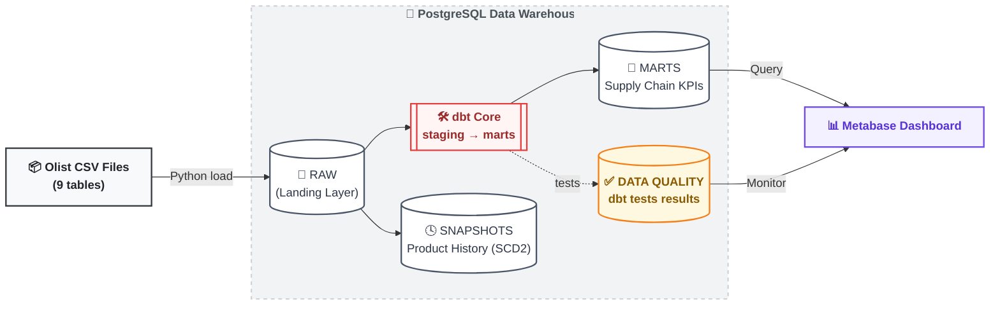

# Olist E-Commerce & Supply Chain Intelligence

This project is an end-to-end data platform that powers analytics for a Brazilian e-commerce marketplace ecosystem. It ingests transaction records from Olist and transforms raw operational data into a trusted analytical foundation.

The architecture is built around four core stages:

- **Ingestion & Storage:** Automated CSV ingestion from Olist datasets into PostgreSQL, with row validation.
- **Transformation & Modeling:** ELT data warehouse built with dbt Core, featuring historical tracking using Slowly Changing Dimensions (SCD Type 2) for products and dimensional models for orders, payments, and logistics.
- **Monitoring & Quality:** Data Quality framework with automated health checks, dbt tests, and Data Health Tiles.
- **Business Intelligence:** Metabase dashboards providing insights into marketplace performance, delivery operations, and data quality.

The result is a governed analytical ecosystem that delivers insights into marketplace performance, seller health, customer behavior, and supply chain efficiency.

## Architecture


## Stack

- Ubuntu
- Docker
- PostgreSQL
- Python
- dbt Core
- dbt-postgres
- Metabase
- GitHub Actions

## Project Structure

```text
.
├── .github/
│   └── workflows/
│       └── ci.yml
├── database/
│   ├── init/
│   └── sql/
├── scripts/
│   └── load_raw.py
├── dbt_project/
│   ├── models/
│   ├── snapshots/
│   ├── tests/
│   ├── dbt_project.yml
│   ├── packages.yml
│   └── profiles.yml.example
├── data/              # ignored by Git
├── .env               # ignored by Git
├── docker-compose.yml
├── requirements.txt
└── README.md
```

## Data Source

The project uses the **Brazilian E-Commerce Public Dataset by Olist**, available on Kaggle.

[Olist Brazilian E-Commerce Dataset](https://www.kaggle.com/datasets/olistbr/brazilian-ecommerce)

## Phase 1 — Raw Layer & Staging

The first phase builds the PostgreSQL raw layer and prepares the dbt transformations.

### Data Ingestion

The `scripts/load_raw.py` script checks the CSV files, loads them into PostgreSQL using `COPY`, and validates the loaded row counts.

### dbt Setup

The project uses dbt Core with the PostgreSQL adapter, along with `dbt_utils` and `dbt_expectations`.

Database credentials are managed locally and are not committed to the repository.

### Product Snapshot — SCD Type 2

`snap_olist.snp_products` tracks historical changes in product attributes using dbt snapshots (SCD Type 2).

### Staging Models

Six staging models standardize the raw data:

- `stg_customers`
- `stg_orders`
- `stg_order_items`
- `stg_payments`
- `stg_products`
- `stg_sellers`

## Phase 2 — Analytical Modeling & Data Quality

This phase builds the analytical foundation of the project, combining business metrics, data quality monitoring, and analytical documentation.

| Model | Purpose |
|---|---|
| `dim_products` | Product attributes and historical versions |
| `fct_orders` | Order lifecycle and delivery performance |
| `fct_order_items` | Item prices, freight costs and item value |
| `fct_payments` | Payment methods, values and installments |
| `mart_supply_chain_kpis` | Aggregated supply chain performance indicators |
| `mart_data_health` | Data quality monitoring across orders, payments and logistics |

### Data Quality & Monitoring

The project uses dbt tests to identify data inconsistencies and validate analytical reliability.

**Latest full test run:**

| Result | Count |
|---|---:|
| Passed | 64 |
| Warnings | 3 |
| Errors | 0 |
| Total Tests | 67 |

The warnings correspond to known anomalies in the source data, mainly related to inconsistent order, pickup, and delivery dates. These issues are flagged rather than artificially corrected.

## Phase 3 — Supply Chain Dashboard & Exposures

The **Olist Supply Chain Intelligence** dashboard, built with Metabase, provides an overview of marketplace performance, delivery operations, and data quality.

### Dashboard Preview

[.png)](https://postimg.cc/MvPGxW3Q)

### Dashboard Visualizations

- **Monthly Order Volume** — tracks order trends over time.
- **Monthly Late Orders** — monitors late delivery trends.
- **Data Quality Issues by Category** — highlights data quality issues across the dataset.

### dbt Exposures

The `olist_supply_chain_dashboard` exposure documents the downstream Metabase dashboard and its dependencies on analytical models.

## Phase 4 — Continuous Integration (CI)

The project includes an automated CI pipeline implemented with **GitHub Actions**.

Triggered by pushes and pull requests targeting the `master` branch, the workflow automatically:

- Downloads the Olist dataset from Kaggle.
- Starts a temporary PostgreSQL database.
- Loads raw data using Python.
- Validates and builds the dbt project.
- Executes snapshots and data quality tests.

**Latest CI execution: Successful.**

The pipeline runs independently of the local environment, ensuring reproducibility and early detection of integration issues.
