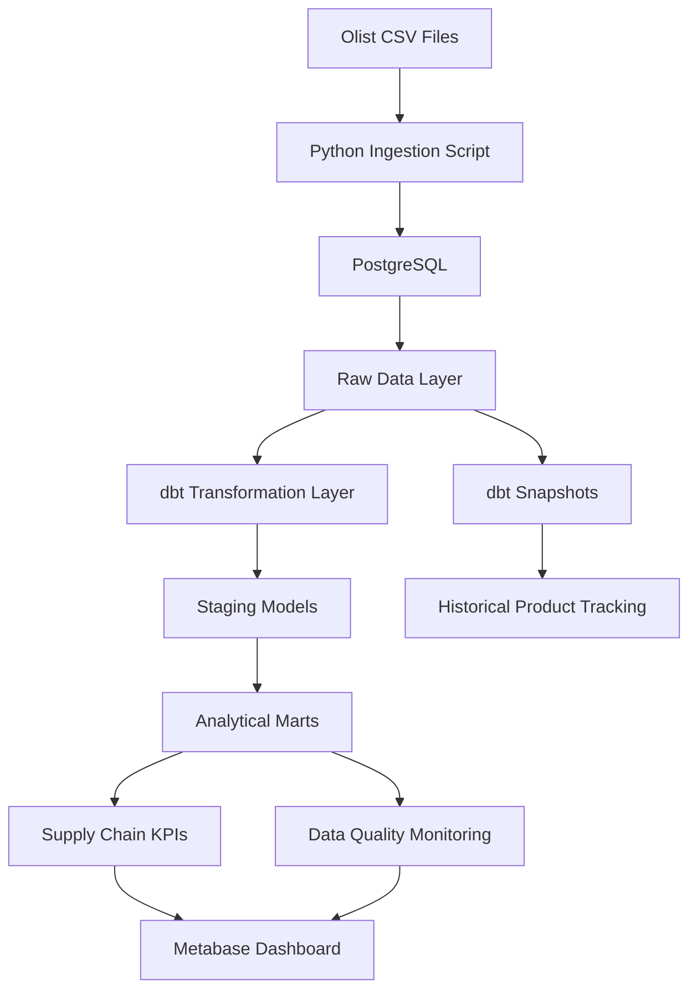

# Olist E-Commerce & Supply Chain Intelligence

This project is an end-to-end data platform that powers analytics for a Brazilian e-commerce marketplace ecosystem. It ingests transaction records from Olist sellers and transforms raw operational data into a trusted, production-grade analytical foundation.

The architecture is built around three core stages:

* **Ingestion & Storage**: Automated CSV ingestion from Olist datasets into PostgreSQL raw schema, with built-in row validation and data lineage tracking.
* **Transformation & Modeling**: ELT data warehouse built with dbt Core, featuring historical tracking using Slowly Changing Dimensions (SCD Type 2) for products and sellers, and comprehensive dimensional models for orders, payments, and logistics.
* **Monitoring & Quality**: Rigorous Data Quality framework with automated health checks and Data Health Tiles that ensure analytical reliability across the entire pipeline.

The result is a governed data ecosystem that delivers trustworthy insights into marketplace performance, seller health, customer behavior, and supply chain efficiency.

## Current architecture



## Stack

- Ubuntu
- Docker 
- PostgreSQL 
- Python 
- dbt Core
- dbt-postgres

## Project structure
 
```
.
├── database/
│   ├── init/
│   │   └── 01_create_schema.sql
│   └── sql/
│       └── 01_create_raw_tables.sql
│
├── scripts/
│   └── load_raw.py
│
├── dbt_project/
│   ├── analyses/
│   ├── macros/
│   ├── models/
│   │   └── sources.yml
│   ├── snapshots/
│   │   └── snp_products.sql
│   ├── seeds/
│   ├── tests/
│   ├── dbt_project.yml
│   ├── packages.yml
│   ├── package-lock.yml
│   └── profiles.yml.example
│
├── data/              # ignored by Git
├── .env               # ignored by Git
├── docker-compose.yml
├── requirements.txt
└── README.md
```

## Phase 1 — Raw layer & staging

The first phase builds the PostgreSQL raw layer and prepares the dbt transformations.

### Data ingestion

The `scripts/load_raw.py` script checks the CSV files, loads them into PostgreSQL using `COPY`, and validates the loaded row counts.

### dbt setup

dbt Core with the PostgreSQL adapter, the `dbt_utils` and `dbt_expectations` packages, and a `profiles.yml.example` template. The local dbt profile (`~/.dbt/profiles.yml`) is not committed because it contains database credentials.

### Product snapshot — SCD Type 2

`snap_olist.snp_products` keeps the history of product attribute changes using a dbt snapshot (SCD Type 2). When a tracked attribute changes, the previous version is closed and a new one is created instead of overwriting the record.

### Staging models

Six staging models (`stg_customers`, `stg_orders`, `stg_order_items`, `stg_payments`, `stg_products`, `stg_sellers`) provide a standardized interface to the raw tables. The 1,000-row development limit has been removed: they now run on the full datasets.

## Phase 2 — Analytical Modeling & Data Quality 

This phase builds the analytical foundation of the project, combining business metrics, data quality monitoring and downstream analytics documentation.

| Model | Purpose |
|---|---|
| `dim_products` | Product attributes and historical versions |
| `fct_orders` | Order lifecycle and delivery performance |
| `fct_order_items` | Item prices, freight costs and item value |
| `fct_payments` | Payment methods, values and installments |
| `mart_supply_chain_kpis` | Aggregated supply chain performance indicators |
| `mart_data_health` | Data quality monitoring across orders, payments and logistics |

### Data Quality & Monitoring

The project uses dbt tests to identify data inconsistencies and validate the reliability of analytical models.

Latest full test run:

| Result | Count |
|---|---:|
| Passed | 64 |
| Warnings | 3 |
| Errors | 0 |
| Total Tests | 67 |

The warnings come from known anomalies in the source data (inconsistent order, pickup and delivery dates), which are flagged rather than artificially corrected.


## Phase 3 — Supply Chain Dashboard & Exposures

The **Olist Supply Chain Intelligence** dashboard, built with Metabase, provides an overview of marketplace performance, delivery operations and data quality.

[.png)](https://postimg.cc/MvPGxW3Q)

### Dashboard Visualizations

- **Monthly Order Volume** — tracks order trends over time.
- **Monthly Late Orders** — monitors late delivery trends.
- **Data Quality Issues by Category** — highlights data quality issues across the dataset.

The dashboard brings business KPIs and data quality indicators together in a single interface to support supply chain performance analysis.

### dbt Exposures

The `olist_supply_chain_dashboard` exposure documents the downstream Metabase dashboard and its relationship with the analytical models.

This provides visibility into how the transformed data is consumed by business intelligence tools and helps document dependencies between the data warehouse and its reporting layer.
